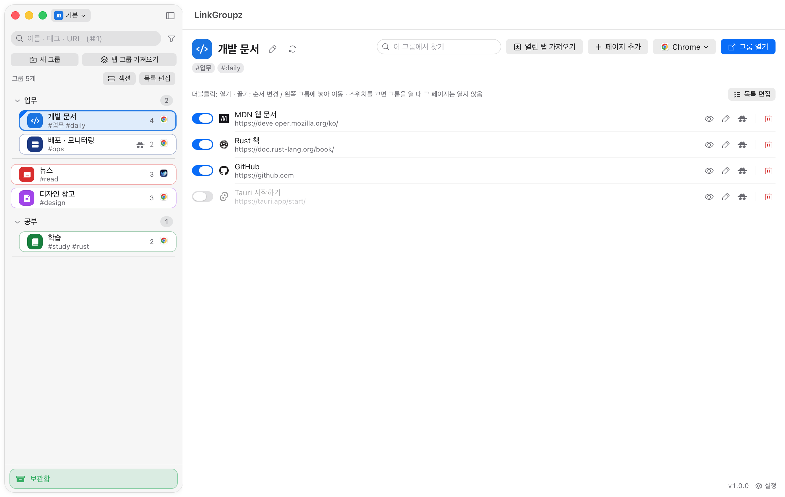
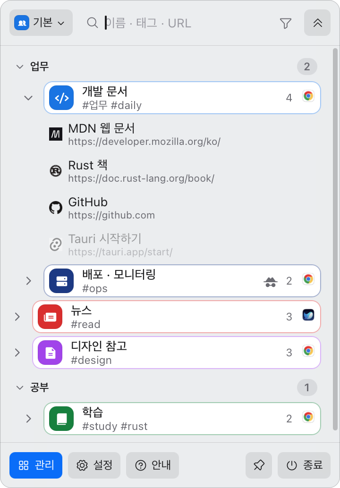

# LinkGroupz

[English](README.md) | **한국어**

자주 여는 웹 페이지를 그룹으로 묶어 두고, 메뉴바(Windows 는 트레이)에서 그룹 하나를 Chrome · Edge · Whale 에 한 번에 여는 앱입니다.

<p align="center">
  
  
</p>

## 기능

- **그룹으로 묶기** — 그룹마다 색 · 아이콘(기본 모양 또는 내 이미지) · 태그, 페이지마다 이름(alias)과 사이트 아이콘. 그룹을 섹션으로 묶어 접고 펼칩니다.
- **한 번에 열기** — 그룹 이름 · 색이 붙은 탭 그룹으로, 또는 새 창에 모두. 그룹마다 Chrome · Edge · Whale 중에서 브라우저를 고릅니다. 시크릿(InPrivate) 창으로도 열고, 그룹마다 '항상 시크릿 모드로 열기'를 켤 수 있습니다.
- **페이지 스위치** — 끄면 그룹을 열 때 그 페이지는 열지 않습니다.
- **브라우저에서 가져오기** — 열린 탭 · 탭 그룹, 브라우저에 저장된 닫힌 탭 그룹까지. 같은 이름의 브라우저 탭 그룹과 비교해 페이지를 더하고 빼거나 통째로 맞춥니다.
- **검색** — 그룹 이름 · `#태그` · 이름 · URL 로 찾고 맞는 글자를 강조합니다. 찾을 곳을 고르거나 그룹 안에서만 찾습니다.
- **메뉴바 창** — 관리 창을 열지 않고 찾아서 엽니다. 키보드 이동 · 오른쪽 클릭 메뉴 · 끌어 놓기, 메뉴바에서 떼어 놓기와 크기 조절, 단축키로 열기.
- **미리보기** — 브라우저를 열지 않고 작은 창에서 페이지를 확인합니다.
- **보관함** — 지우지 않고 치워 두고, 끌어 넣고 끌어 꺼냅니다.
- **되돌리기 · 다시 실행** — ⌘Z · ⌘⇧Z (Windows 는 Ctrl+Z · Ctrl+Y). 그룹 · 페이지 · 섹션 · 보관함을 바꾼 일을 되돌립니다.
- **프로필** — 회사 · 개인처럼 그룹 목록을 따로 둡니다.
- **데이터** — 내보내기 · 가져오기(아이콘 이미지 포함), 하루 한 번 자동 백업과 되돌리기.
- **한국어 · 영어** — 시스템 언어를 따르고, 설정에서 바꿀 수 있습니다.
- **라이트 · 다크** — 시스템 화면 모드를 따르고, 설정에서 라이트나 다크로 고를 수 있습니다.
- **자동 업데이트** — GitHub 릴리스에서 서명을 확인한 뒤 설치합니다.

## 필요한 것

- macOS 13 Ventura 이상, Apple Silicon(M1 이후) Mac. Intel Mac 에서는 실행되지 않습니다.
- Windows 10 · 11 (64비트)
- Google Chrome · Microsoft Edge · Naver Whale 중 하나

## 설치

[Releases](https://github.com/zbeosf/linkgroupz/releases/latest) 에서 최신 버전을 받습니다.

- **macOS** — `LinkGroupz-x.y.z.dmg` 를 열어 LinkGroupz 를 Applications 로 끌어 놓습니다. 공증하지 않은 앱이라 처음 열 때 막히면 **완료**를 누르고, **시스템 설정 → 개인정보 보호 및 보안**에서 **그래도 열기**를 누릅니다.
- **Windows** — `LinkGroupz-x.y.z-setup.exe` 를 실행합니다. 관리자 권한 없이 내 계정에만 설치됩니다. **Windows 의 PC 보호** 창이 뜨면 **추가 정보 → 실행**을 누릅니다.

브라우저 확장은 꼭 필요하지는 않지만 권장합니다. 설치하면 그룹을 이름 · 색이 붙은 탭 그룹으로 열고, 열린 탭을 바로 읽어 옵니다. 앱의 시작 안내 창이 설치 방법을 알려 주고, [INSTALL.ko.md](INSTALL.ko.md) 에도 같은 내용이 있습니다.

## 사용법

메뉴바 아이콘을 눌러 그룹을 찾아 열고, **관리**를 눌러 그룹과 페이지를 편집합니다. 그림이 들어간 사용법은 앱 안(시작 안내 창 → **사용법 보기**)과 [docs/guide](docs/guide/index.html) 에 있습니다.

## 소스에서 빌드하기

Rust 1.90 이상이 필요합니다. macOS 는 Xcode Command Line Tools, Windows 는 [Tauri 준비물](https://tauri.app/start/prerequisites/)이 필요합니다.

```bash
cargo xtask host          # Native Messaging 호스트 빌드 (앱을 처음 빌드하기 전에 한 번)
cargo run -p linkgroupz   # 개발 빌드로 실행
cargo test --workspace    # 테스트
cargo xtask dist          # dist/ 에 설치 파일 만들기
```

구조 · 확장과 주고받는 방식 · 자동 업데이트 · 릴리스 절차는 [docs/DEVELOPMENT.md](docs/DEVELOPMENT.md) 에 있습니다.

## 라이선스

[MIT](LICENSE) © kingdom8 (zbeosf)

앱에 들어가는 외부 코드의 라이선스는 [THIRD-PARTY-LICENSES.html](THIRD-PARTY-LICENSES.html) 에 있습니다.

LinkGroupz 는 macOS 앱 LinkGroups 를 옮겨 만든 것입니다. 원작자는 이름을 밝히지 않기를 원했습니다. LinkGroups 의 데이터 파일도 읽을 수 있습니다.
