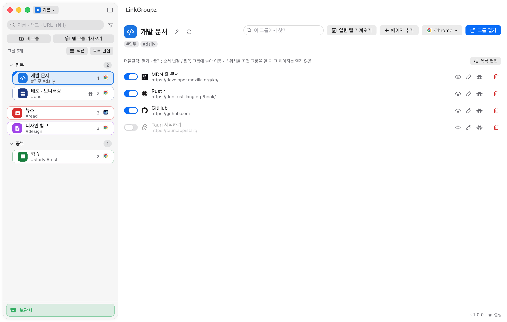
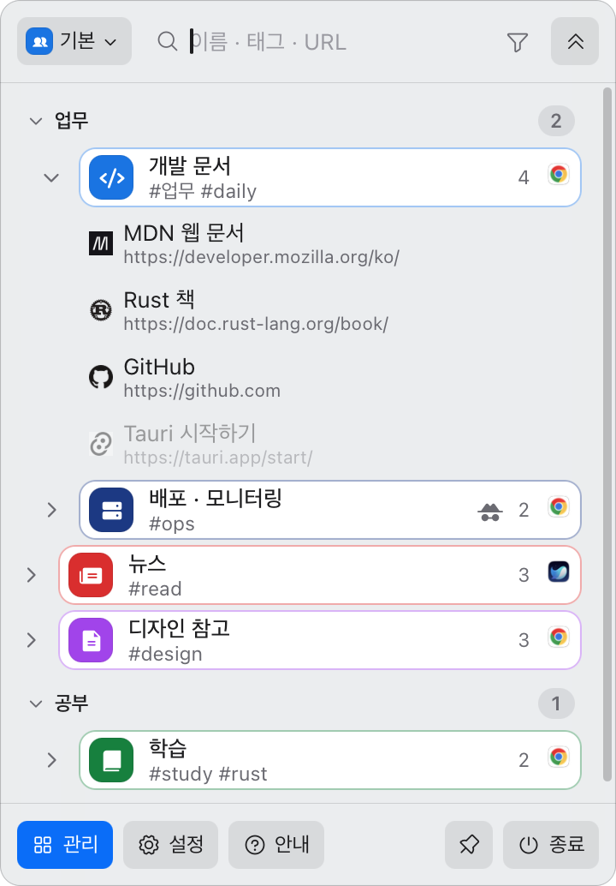

# LinkGroupz

**English** | [한국어](README.ko.md)

Keep the web pages you open every day in groups, and open a whole group in Chrome, Edge or Whale with one click from the menu bar (the system tray on Windows).

<p align="center">
  
  
</p>

> The app is available in English and Korean. It follows your system language, and you can change it in Settings.

## Features

- **Groups of pages** — a color, icon (built-in shapes or your own image) and tags for each group, an alias and site icon for each page. Fold groups into sections.
- **Open a group at once** — as a named, colored tab group, or all in a new window. Pick Chrome, Edge or Whale per group. Private (InPrivate) windows are supported, with an "always private" option per group.
- **Page switches** — turn a page off to skip it when its group opens.
- **Import from the browser** — open tabs and tab groups, including saved (closed) tab groups. Sync a group with the browser tab group of the same name: add, remove or replace pages.
- **Search** — by group name, `#tag`, alias or URL with highlighted matches. Choose which fields to search, or search inside one group.
- **Menu bar window** — search and open without the main window. Keyboard navigation, right-click menus and drag and drop; detach and resize it; show it with a global shortcut.
- **Preview** — check a page in a small window without opening the browser.
- **Archive** — put groups and pages away instead of deleting them; drag them in and back out.
- **Undo and redo** — ⌘Z / ⌘⇧Z (Ctrl+Z / Ctrl+Y on Windows) for changes to groups, pages, sections and the archive.
- **Profiles** — separate group lists, for example for work and personal use.
- **Your data** — export and import (icon images included), and automatic daily backups you can restore.
- **English and Korean** — follows the system language; change it in Settings.
- **Light and dark** — follows the system appearance, or choose Light or Dark in Settings.
- **Automatic updates** — signed updates from GitHub Releases.

## Requirements

- macOS 13 Ventura or later on Apple Silicon (M1 or later). Intel Macs are not supported.
- Windows 10 or 11 (64-bit)
- Google Chrome, Microsoft Edge or Naver Whale

## Installation

Download the latest version from [Releases](https://github.com/zbeosf/linkgroupz/releases/latest).

- **macOS** — open `LinkGroupz-x.y.z.dmg` and drag LinkGroupz to Applications. The app is not notarized, so macOS blocks it the first time: click **Done**, then open **System Settings → Privacy & Security** and click **Open Anyway**.
- **Windows** — run `LinkGroupz-x.y.z-setup.exe`. It installs for the current user without admin rights. If SmartScreen appears, click **More info → Run anyway**.

The browser extension is optional but recommended. With it, groups open as named, colored tab groups and LinkGroupz reads your open tabs directly. The app's welcome window walks you through installing it; [INSTALL.md](INSTALL.md) has the same steps.

## Usage

Click the menu bar icon to search and open groups, and click **관리** (Manage) to edit groups and pages. An illustrated guide is built into the app (welcome window → **사용법 보기**) and is also in [docs/guide](docs/guide/en/index.html).

## Building from source

You need Rust 1.90 or later, plus the Xcode Command Line Tools on macOS or the [Tauri prerequisites](https://tauri.app/start/prerequisites/) on Windows.

```bash
cargo xtask host          # build the native messaging host (once, before the first app build)
cargo run -p linkgroupz   # run a development build
cargo test --workspace    # run the tests
cargo xtask dist          # build an installer into dist/
```

Architecture, the extension protocol, updates and the release process are described in [docs/DEVELOPMENT.md](docs/DEVELOPMENT.md) (in Korean).

## License

[MIT](LICENSE) © kingdom8 (zbeosf)

Licenses of the third-party code bundled with the app are listed in [THIRD-PARTY-LICENSES.html](THIRD-PARTY-LICENSES.html).

LinkGroupz is a port of LinkGroups, a macOS app whose author prefers not to be named. It can read LinkGroups data files.
